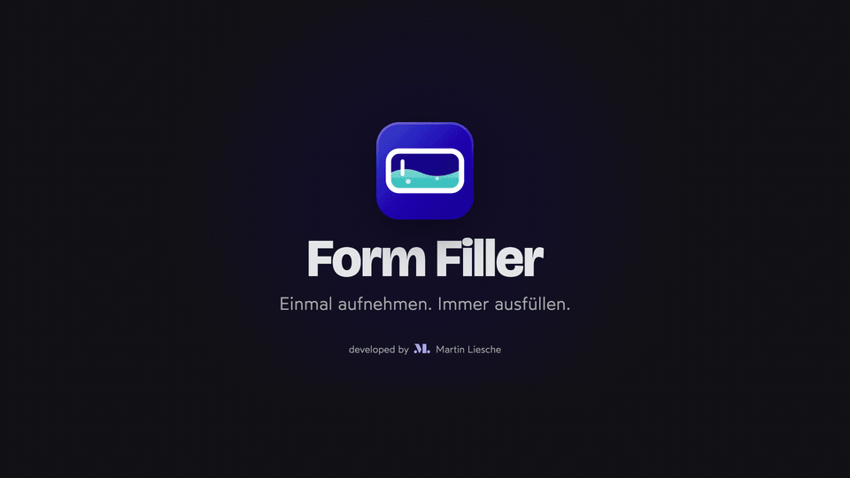

# Form Filler



Chromium-Erweiterung (Manifest V3), die Webformulare mit zusammenhängenden deutschen Testdaten befüllt. Die Felder einer Seite werden einmal als Vorlage aufgenommen; danach genügt ein Klick oder ein Tastenkürzel. Datensätze bleiben über mehrteilige Prozesse hinweg konsistent (gleiche Kennung, gleiche Person, gleiche Adresse).

## Funktionen

- **Vorlagen per Aufnahme:** Felder einer Seite anklicken, Datentyp prüfen, speichern. Kein Code, keine Selektoren von Hand.
- **Schnellfüllen:** „Ohne Vorlage füllen“ erkennt die Felder einer Seite selbst und füllt sie sofort, ohne App und ohne Berechtigung; das Tastenkürzel tut dasselbe, wenn es keine Vorlage für die Seite gibt. Die Erkennung lässt sich danach als Vorlage speichern.
- **Realistische deutsche Testdaten:** Namen, Adressen mit passender PLZ und Ort, Telefon, E-Mail, IBAN, Datum, Firmen und mehr. Jeder Durchlauf erzeugt neue Werte.
- **Stimmige Datensätze:** Zusammengehörige Felder passen zueinander, auch über mehrere Formularschritte hinweg.
- **Viele Feldarten:** Textfelder, Selects, Radio-Buttons, Checkboxen, Datumsfelder sowie eigene, barrierefreie Komponenten (ARIA-Combobox, ARIA-Radiogroup, Auswahl-Buttons mit `aria-haspopup="listbox"` wie in Headless UI oder Nuxt UI), auch in Web-Components (offenes Shadow DOM) und in eingebetteten Formularen derselben Adresse.
- **Mitdenkendes Tastenkürzel:** Alt+Shift+F füllt mit der passenden Vorlage der erkannten App, bei Prozessen mit dem nächsten Schritt; ohne App oder Vorlage füllt es die Seite ohne Vorlage.
- **Datensatz im Blick:** Das Popup zeigt Kennung, Firma und Person des aktiven Datensatzes; „Neuer Datensatz“ beginnt einen neuen Durchlauf.
- **Pflegbar:** Felder ergänzen, entfernen, umsortieren und als Pflicht oder optional markieren; Vorlagen duplizieren. Export und Import als JSON.
- **Lokal:** Keine Server, kein Tracking, keine Synchronisierung.

Was sich von Version zu Version ändert, steht im [Changelog](CHANGELOG.md).

## Video

Das vollständige Produktvideo (knapp eine Minute, ohne Ton) zeigt App-Erkennung, Aufnahme, Ausfüllen, Tastenkürzel und Verwaltung. Es wird hier eingebettet, sobald es hochgeladen ist.

<!-- Video-Link nach dem Upload hier eintragen -->

Beides wird aus dem Repository gerendert, die Animation liegt in `promo/video/`:

```sh
npm run video:preview   # Vorschau im Browser mit Play und Scrubber
npm run video:render    # MP4 nach promo/video/out/form-filler.mp4
npm run video:teaser    # GIF nach docs/media/teaser.gif
```

Voraussetzungen: Google Chrome und `ffmpeg` (`brew install ffmpeg`). Damit die Fließtexte im Video der Marke entsprechen, muss Wotfard lokal vorliegen (siehe „Schriften“); sonst rendert das Video mit der Systemschrift.

## Installation

Die Erweiterung ist nicht im Chrome Web Store. Du baust sie einmal lokal und lädst sie als entpackte Erweiterung.

### Voraussetzungen

- [Git](https://git-scm.com)
- [Node.js](https://nodejs.org) in einer aktuellen LTS-Version (getestet mit Node.js 22) samt npm
- Ein Chromium-Browser, z. B. Dia, Arc, Chrome, Edge oder Brave, oder Firefox ab 140

### 1. Herunterladen und bauen

```sh
git clone https://github.com/marliedev/form-filler.git
cd form-filler
npm ci
npm run build
```

Das Ergebnis liegt im Ordner `.output/chrome-mv3`.

### 2. Im Browser laden

Der Ablauf ist bei allen Chromium-Browsern gleich:

1. Die Erweiterungsseite öffnen: `chrome://extensions` in die Adresszeile eingeben oder über das Browsermenü „Erweiterungen verwalten“.
2. Den **Entwicklermodus** einschalten (meist ein Schalter oben rechts).
3. **„Entpackte Erweiterung laden“** wählen und den Ordner `.output/chrome-mv3` auswählen.
4. Die Erweiterung an die Symbolleiste anheften, damit das Popup mit einem Klick erreichbar ist.

Die genauen Menü- und Schaltflächennamen können je nach Browser und Version abweichen.

**Firefox** (ab Version 140): mit `npm run build:firefox` bauen, dann `about:debugging#/runtime/this-firefox` öffnen, **„Temporäres Add-on laden“** wählen und die Datei `.output/firefox-mv3/manifest.json` auswählen. Ein temporäres Add-on verschwindet beim Beenden von Firefox. Dauerhaft installieren lässt sich nur ein von Mozilla signiertes Paket, siehe „Firefox: signieren und verteilen“.

#### Firefox: signieren und verteilen

Mozilla signiert selbst verteilte Add-ons kostenlos und automatisch, ohne Eintrag im Add-on-Store. Einmalig einrichten:

1. Ein [Mozilla-Entwicklerkonto](https://addons.mozilla.org/developers/) anlegen und unter [API-Schlüssel](https://addons.mozilla.org/developers/addon/api/key/) ein Schlüsselpaar erzeugen.
2. `.env.example` nach `.env` kopieren und beide Werte eintragen. Die Datei bleibt lokal (gitignored).

Je Version:

1. Die `version` in `package.json` erhöhen; Mozilla signiert jede Versionsnummer nur einmal.
2. `npm run sign:firefox` baut, prüft das Paket mit Mozillas Linter, lädt es zur Signierung hoch und legt die signierte Datei unter `.output/firefox-signed/` ab (dauert meist wenige Minuten).
3. Die `.xpi`-Datei weitergeben. Installation: Datei in ein Firefox-Fenster ziehen oder über `about:addons` → Zahnrad → „Add-on aus Datei installieren“. Das Add-on bleibt dauerhaft installiert; Updates werden ebenfalls per Datei verteilt.

### 3. Aktualisieren

```sh
git pull
npm ci
npm run build
```

Danach auf der Erweiterungsseite bei Form Filler auf **Neu laden** klicken und offene Tabs der Zielseite neu laden. Apps und Vorlagen bleiben dabei erhalten.

### Häufige Probleme

- **Popup meldet fehlende Berechtigung:** Die Erweiterung fragt pro App einmal nach Zugriff auf die Seite. Ohne diese Freigabe kann sie dort weder aufnehmen noch füllen.
- **Nach einem Update passiert auf der Seite nichts:** Den Tab neu laden. Bereits offene Seiten laufen sonst noch mit der alten Version.
- **Tastenkürzel reagiert nicht (Arc unter Windows):** Arc gibt dort Tastenkürzel nicht an Erweiterungen weiter. In Chrome und unter macOS funktioniert es; in Arc unter Windows über das Popup füllen.
- **`npm ci` schlägt fehl:** Node.js-Version prüfen (`node -v`) und gegebenenfalls auf die aktuelle LTS-Version aktualisieren.

## Erste Schritte

Zum Ausprobieren reicht ein Klick: Zielseite öffnen, Popup starten, **Ohne Vorlage füllen**. Der Bericht zeigt, welche Felder erkannt wurden; **Als Vorlage speichern** übernimmt die Erkennung in eine Vorlage (und legt bei Bedarf die App an), die sich im Pflege-Tab verfeinern lässt. Für mehrstufige Prozesse und Sonderfälle führt der Weg über eine aufgenommene Vorlage:

1. Die Zielseite öffnen und das Popup der Erweiterung starten.
2. **Neue App für diese Seite** anlegen (Name und URL-Muster) und die angeforderte Berechtigung für die Seite erteilen.
3. **Neue Vorlage** anlegen; die Aufnahme startet auf der Seite.
4. Felder anklicken bzw. fokussieren, Datentyp und Optionen im Popover prüfen und übernehmen, mit „Speichern“ beenden.
5. Im Popup **Füllen** wählen („Alle“ oder „Nur Pflicht“). Nicht gefundene oder nicht befüllbare Felder werden im Bericht mit Warnung angezeigt.

Bei mehrteiligen Prozessen bleibt die Kennung zwischen den Schritten gleich; **Neuer Datensatz** beginnt einen neuen Durchlauf.

## Tastenkürzel

Standard: **Alt+Shift+F** füllt die aktuelle Seite. Auf einer Seite mit erkannter App nimmt das Kürzel deren einzige Vorlage; bei mehreren Vorlagen den nächsten Schritt des zuletzt gefüllten Prozesses (nach dem letzten Schritt wieder Schritt 1), sonst die zuletzt genutzte Vorlage. Ohne erkannte App oder ohne Vorlage füllt das Kürzel die Seite ohne Vorlage (Schnellfüllen). Ändern lässt sich das Kürzel auf der Kürzel-Seite der Erweiterungsverwaltung des Browsers (bei Chromium-Browsern meist `chrome://extensions/shortcuts`, in Firefox unter `about:addons` → Zahnrad → „Tastenkürzel für Erweiterungen verwalten“).

## Datenschutz

Alle Daten bleiben lokal im Browser: Apps und Vorlagen in `storage.local`, Füllstände und Berichte pro Tab in `storage.session`. Es gibt keine Synchronisierung (`storage.sync` wird nicht verwendet) und keine Netzwerkzugriffe zur Laufzeit.

## Export und Import

Im Pflege-Tab („Vorlagen verwalten“, Zahnrad im Popup) lassen sich Apps und Vorlagen als JSON-Datei exportieren und wieder importieren. Bei Konflikten fragt der Import nach.

## Keine App-Vorlagen im Repository

App-spezifische Vorlagen und Exporte gehören nicht ins Repository. Sie bleiben lokal bzw. werden außerhalb des Repos weitergegeben.

## Eigenes Theme (lokal)

Die Oberfläche nutzt ein dunkles Standard-Theme. Farben lassen sich lokal anpassen, ohne das Repository zu ändern:

1. `src/theme/theme.local.example.css` nach `src/theme/theme.local.css` kopieren.
2. In der Kopie nur die gewünschten Variablen (z. B. `--color-brand`, `--color-surface`) einkommentieren und ändern.
3. Neu bauen (`npm run build`) und die Erweiterung neu laden.

Die Datei gilt für Popup, Verwaltungsseite und die Aufnahme-Leiste. Sie ist per `.gitignore` ausgeschlossen und wird nie eingecheckt. Fehlt sie, baut die Erweiterung unverändert mit dem Standard-Theme. Beim Anpassen auf ausreichenden Kontrast achten (Text mindestens 4,5:1).

## Schriften

Überschriften nutzen [Bricolage Grotesque](https://fonts.google.com/specimen/Bricolage+Grotesque) (SIL Open Font License), die im Repository liegt. Für Fließtext ist Wotfard (Atipo Foundry) vorgesehen. Wotfard ist nicht frei lizenziert und deshalb nicht enthalten; ohne sie nutzt die Oberfläche die Systemschrift.

Wer eine Wotfard-Lizenz hat, legt die Dateien lokal ab:

1. `wotfard-light.woff2` (300) und `wotfard-medium.woff2` (500) nach `src/theme/fonts/local/` kopieren.
2. Neu bauen (`npm run build`) und die Erweiterung neu laden.

Der Ordner ist per `.gitignore` ausgeschlossen.

## Testseite

```sh
npm run test-site
```

Startet eine lokale Testseite mit allen unterstützten Feldarten für Aufnahme- und Füll-Tests.

## Entwicklung

| Befehl | Zweck |
| --- | --- |
| `npm run dev` | Entwicklungsmodus (WXT) |
| `npm run build` | Produktions-Build nach `.output/chrome-mv3` |
| `npm run typecheck` | Typprüfung (vue-tsc) |
| `npm run lint` | ESLint |
| `npm test` | Unit-Tests (Vitest) |
| `npm run test:e2e` | Browsertest (Playwright): baut die Erweiterung im Modus `e2e`, startet die Testseite und füllt sie in einem echten Chromium |
| `npm run test-site` | Lokale Testseite |

Der Browsertest braucht einmalig `npx playwright install chromium`. Er lädt den Build aus `.output/chrome-mv3-e2e`, der sich vom Produktions-Build nur durch den Zugriff auf `localhost` und eine Testschnittstelle im Hintergrundprozess unterscheidet.

Das Icon liegt als SVG in `assets/icon/` (`icon.svg` ab 48 px, `icon-small.svg` für 16 und 32 px); die PNGs in `public/icon/` sind daraus gerendert.

Manuelle Prüfungen im echten Browser: [docs/manual-test-checklist.md](docs/manual-test-checklist.md).

## Datenquellen

Die Postleitzahlen-Daten stammen von [GeoNames](https://www.geonames.org) und stehen unter [Creative Commons Attribution 4.0](https://creativecommons.org/licenses/by/4.0/). Details: [src/data/README.md](src/data/README.md).

Telefon- und Mobilnummern stammen aus den Rufnummernblöcken, die die [Bundesnetzagentur für Medienproduktionen reserviert](https://www.bundesnetzagentur.de/DE/Fachthemen/Telekommunikation/Nummerierung/DramaNumbers/artikel.html) („Drama Numbers“). Sie sind keinem Anschluss zugeteilt, Testdaten erreichen also nie eine echte Person. BIC und Bankname sind echte Paare deutscher Banken; die IBAN hat eine gültige Prüfsumme, ihre Bankleitzahl ist zufällig.
